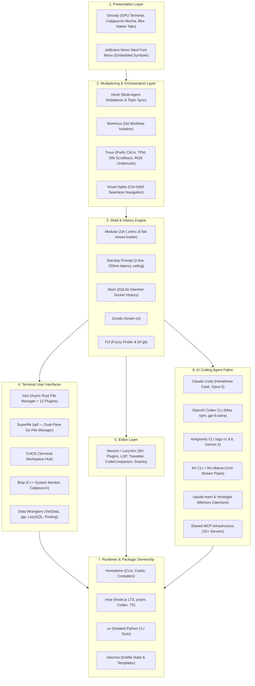
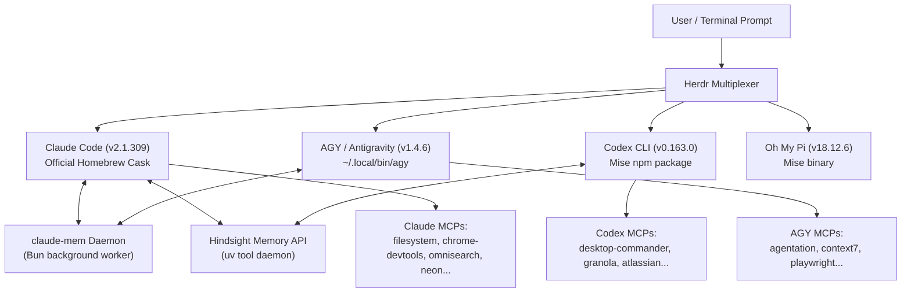

# 🚀 sam-setup

> **One line, walk away, come back to a Mac that works like mine** — an identical, zero-friction, production-grade replica of an elite developer terminal environment: Ghostty, Neovim (LazyVim with 30+ plugins), Herdr multi-agent multiplexer, Tmux, Starship, Atuin, modern CLI replacements, terminal file managers (Yazi with 12 plugins, Superfile, TUIOS), system monitors (Btop), AI coding agents (Claude Code, OpenAI Codex CLI, AGY / Antigravity CLI, llm), and polyglot runtimes. Your identity stays yours; none of my secrets or private history come along.

<p align="center">
  <a href="https://github.com/sambatia/sam-setup/releases"></a>
  <a href="https://www.apple.com/macos/"></a>
  <a href="https://www.gnu.org/software/bash/"></a>
  <a href="https://github.com/sambatia/sam-setup/actions"></a>
  <a href="LICENSE"></a>
</p>

---

## 📋 Table of Contents

- [The Experience: What It Feels Like](#-the-experience-what-it-feels-like)
- [Architecture & System Wiring](#-architecture--system-wiring)
- [Single-Command Installation](#-single-command-installation)
  - [Installation Profiles](#installation-profiles)
  - [What Happens Under the Hood](#what-happens-under-the-hood)
- [AI Coding Agent Ecosystem](#-ai-coding-agent-ecosystem)
  - [1. Anthropic Claude Code](#1-anthropic-claude-code)
  - [2. OpenAI Codex CLI](#2-openai-codex-cli)
  - [3. Google Antigravity CLI (AGY)](#3-google-antigravity-cli-agy)
  - [4. CLI LLM Pipelines (llm & Ollama)](#4-cli-llm-pipelines-llm--ollama)
  - [5. Agent Multiplexing & Orchestration (Herdr & Workmux)](#5-agent-multiplexing--orchestration-herdr--workmux)
  - [6. Model Context Protocol (MCP) Infrastructure](#6-model-context-protocol-mcp-infrastructure)
  - [7. Universal Cross-Agent Memory (claude-mem & Hindsight)](#7-universal-cross-agent-memory-claude-mem--hindsight)
- [Terminal File Managers & TUIs](#-terminal-file-managers--tuis)
  - [1. Yazi (Asynchronous Graphical File Manager)](#1-yazi-asynchronous-graphical-file-manager)
  - [2. Superfile (spf — Modern Dual-Pane File Manager)](#2-superfile-spf--modern-dual-pane-file-manager)
  - [3. TUIOS (Terminal Workspace Hub)](#3-tuios-terminal-workspace-hub)
  - [4. Btop (Catppuccin Mocha System Monitor)](#4-btop-catppuccin-mocha-system-monitor)
  - [5. Data Wrangling & API TUIs](#5-data-wrangling--api-tuis)
- [Editor Layer: Neovim & LazyVim Complete Stack](#-editor-layer-neovim--lazyvim-complete-stack)
  - [Complete Plugin Inventory by Category](#complete-plugin-inventory-by-category)
  - [Key Neovim Workflows & Triggers](#key-neovim-workflows--triggers)
- [Terminal Emulator, Multiplexer, & Shell](#-terminal-emulator-multiplexer--shell)
  - [1. Ghostty Terminal](#1-ghostty-terminal)
  - [2. Tmux Multiplexer](#2-tmux-multiplexer)
  - [3. Zsh, Starship Prompt, & Atuin History](#3-zsh-starship-prompt--atuin-history)
- [Exhaustive Package Manifest Catalog](#-exhaustive-package-manifest-catalog)
- [Keyboard Shortcuts & Cheatsheet](#-keyboard-shortcuts--cheatsheet)
- [Maintenance & Diagnostic Suite](#-maintenance--diagnostic-suite)
- [Local Customization & Extension Points](#-local-customization--extension-points)
- [Security, Privacy, & Zero-Credential Policy](#-security-privacy--zero-credential-policy)
- [Rollback & Uninstallation](#-rollback--uninstallation)
- [License](#-license)

---

## 🌟 The Experience: What It Feels Like

Most terminal setups are ad-hoc collections of shell aliases, half-broken symlinks, and outdated packages accumulated over years. `sam-setup` is a **cohesively engineered workstation platform** designed around ergonomic flow, microsecond responsiveness, and multi-agent AI pairing:

* **Instant, Beautiful Boot:** Launching your terminal opens Ghostty with GPU acceleration, 90% opacity blur, Catppuccin Mocha palette, and JetBrains Mono Nerd Font typography.
* **Fluid Pane Navigation:** Press `Ctrl + h/j/k/l` to move seamlessly between your Neovim buffer, an interactive terminal pane, a Yazi preview, and an AI agent session without your hands ever leaving the home row.
* **Intelligent Shell History:** Hit `Ctrl + r` or `Up Arrow` to invoke Atuin's SQLite-backed history engine with execution durations, exit codes, multi-line editing, and directory-scoped search.
* **Sub-Second File & Data Exploration:** Navigate directory trees visually with Yazi (complete with Ghostty Kitty graphics previews for images, PDFs, and videos), manage files dual-pane in Superfile (`spf`), slice 500 MB CSVs in under 200 ms with VisiData (`vd`), or prototype complex JSON transforms with `jqp`.
* **Multi-Agent AI Engineering:** Run Claude Code, OpenAI Codex CLI, or Google Antigravity CLI (`agy`) side-by-side inside Herdr with topic synchronization, shared MCP servers, and background memory bridging.
* **Coordinated Single-Command Updates:** Run `update-all` (or `sam-setup-update`) to synchronize Homebrew, Mise runtimes, global Node CLIs, uv tools, LazyVim plugins, Tmux plugins, and dotfiles in a single safe, ownership-aware pass.

---

## 🏗 Architecture & System Wiring

The workstation is layered to guarantee high performance, clear package ownership, and zero PATH conflicts:



---

## ⚡ Single-Command Installation

Paste this single command into macOS Terminal and press Enter:

```bash
/bin/bash -c "$(curl -fsSL https://raw.githubusercontent.com/sambatia/sam-setup/main/bootstrap.sh)"
```

### Installation Profiles

You can choose your footprint depending on your workflow needs:

```bash
# 1. Full Installation (Recommended — Complete AI engineering, Cloud/K8s, DB & Terminal stack)
/bin/bash -c "$(curl -fsSL https://raw.githubusercontent.com/sambatia/sam-setup/main/bootstrap.sh)"

# 2. Core Profile (Lightweight — Shell, Ghostty, LazyVim, Multiplexers, & Modern CLIs only)
/bin/bash -c "$(curl -fsSL https://raw.githubusercontent.com/sambatia/sam-setup/main/bootstrap.sh)" -- --core

# 3. Unattended / Automated (Skips the interactive confirmation prompt)
SAM_SETUP_YES=1 /bin/bash -c "$(curl -fsSL https://raw.githubusercontent.com/sambatia/sam-setup/main/bootstrap.sh)"
```

### What Happens Under the Hood

The `bootstrap.sh` pipeline executes a 10-phase automated setup:

```
[01/10] Pre-flight Guards   ── Verifies macOS 13+, arm64/Intel, >=10 GB disk space, & AC power.
[02/10] Sudo Keep-Alive     ── Caches admin credentials in background so GUI cask downloads never stall.
[03/10] Core Prerequisites  ── Installs Xcode Command Line Tools, Rosetta 2 (if Apple Silicon), & Homebrew.
[04/10] Identity Isolation  ── Prompts for your Name and Git Email to generate your private .gitconfig.
[05/10] Safety Backup       ── Copies existing ~/.zshrc, ~/.tmux.conf, ~/.config/nvim to *.bak-<timestamp>.
[06/10] Toolchain Bundle    ── Installs 120+ curated CLIs, Ghostty, Nerd Fonts, and casks via Brewfile.
[07/10] Polyglot Runtimes   ── Installs Node.js LTS, pnpm, Codex CLI, and Python runtimes via mise and uv.
[08/10] Editor & TUIs Sync  ── Headlessly initializes LazyVim plugins and deploys all 12 Yazi plugins.
[09/10] Multiplexers & TPM  ── Clones tmux TPM plugins and installs Herdr agent integrations (claude, codex, etc.).
[10/10] Health Check        ── Executes sam-setup-check (53 assertions) and offers to launch Ghostty.
```

> [!TIP]
> **Safety Guarantee:** Your pre-existing configuration files are never destroyed. They are backed up to timestamped archives and can be restored at any time with a single command: `sam-setup-restore`.

---

## 🤖 AI Coding Agent Ecosystem

`sam-setup` provides an interconnected, production-ready AI coding fabric with zero configuration friction:



### 1. Anthropic Claude Code
* **Distribution:** Installed via official Homebrew Cask `claude-code@latest` (v2.1.309).
* **Launch Command:** `claude` (aliased to `claudew`, a health guard ensuring memory daemon connectivity before launching).
* **Model:** Default configured for `claude-opus-5`.
* **Security & Permission Engine:**
  - Automated approvals for read-only inspection commands (`git status`, `ls`, `grep`).
  - Strict security deny-rules blocking unauthorized reads to sensitive paths: `Read(**/.env)`, `Read(~/.aws/**)`, `Read(~/.config/gh/**)`, `Read(~/.gnupg/**)`, `Read(~/.netrc)`, `Read(~/.ssh/**)`.
* **Hooks:** Wired into Piclatch clipboard screenshot capture and `claude-mem` automatic memory synthesis.

### 2. OpenAI Codex CLI
* **Distribution:** Managed via `mise` (`npm:@openai/codex` v0.163.0).
* **Launch Command:** `codex`
* **Configuration:** `~/.codex/config.toml`
* **Model Hierarchy:** Powered by `gpt-6-astra` (Reasoning effort: `max`, Plan mode reasoning effort: `high`).
* **Governance & Rules:** Reads project and workspace instructions from `AGENTS.md`. Integrated with `@opengsd/gsd-core` and `gstack` (`garrytan/gstack`) for phased, structured task execution.
* **Multiplexer Integration:** Pre-registered with Herdr (`herdr integration install codex`) for seamless split-pane agent pairing.

### 3. Google Antigravity CLI (AGY)
* **Distribution:** Standalone binary located at `~/.local/bin/agy` (v1.4.6), integrated with Google Antigravity / Gemini 3 models.
* **Launch Command:** `agy` (aliased in interactive shells to `agy --dangerously-skip-permissions` for frictionless pair programming).
* **Ownership & Self-Updating Architecture:**
  > [!NOTE]
  > Homebrew's `antigravity-cli` cask was intentionally retired because `agy` contains an internal background self-updater that continuously replaces Homebrew's symlink with a direct binary, causing `brew upgrade` collision failures. `sam-setup` houses `agy` in `~/.local/bin/agy` where its native updater operates safely without package manager conflicts.
* **Lifecycle Hook Pipeline:** 8 comprehensive lifecycle event bindings (`SessionStart`, `BeforeAgent`, `BeforeTool`, `AfterTool`, `AfterAgent`, `Notification`, `PreCompress`, `SessionEnd`). Hooks into `claude-mem` via Bun on every turn, and runs GitNexus code graph hooks.
* **Orbit HUD:** Custom status line monitoring agent tokens, active tools, and reasoning state.

### 4. CLI LLM Pipelines (llm & Ollama)
* **Distribution:** Installed via Homebrew `brew "llm"`.
* **Local Inference:** Bundled with the `llm-ollama` plugin to connect to local Ollama models (`http://localhost:11434`) with zero cloud latency and zero cost.
* **Unix Pipe Superpower:** Pass logs, diffs, and code directly into LLMs:
  ```bash
  # Explain test failure
  npm test 2>&1 | llm "summarize why the test failed and write the fix"

  # Review git diff
  git diff | llm "review this diff for edge cases and regressions"
  ```

### 5. Agent Multiplexing & Orchestration (Herdr & Workmux)
* **Herdr (`herdr`):** Agent-aware terminal multiplexer. Automatically synchronizes pane titles with active task topics, maintains clean shell states via `herdr-refresh-safe-shell-panes`, and integrates with Neovim via `smart-splits`.
* **Workmux (`workmux`):** Automates Git worktree creation for isolated agent coding in sibling `<repo>__worktrees/` directories, preventing AI agents from modifying your active working tree.

### 6. Model Context Protocol (MCP) Infrastructure
A unified MCP ecosystem pre-configured across Claude Code, Codex, and AGY:

| MCP Server | Transport | Purpose | Security Boundary |
| :--- | :--- | :--- | :--- |
| **`filesystem`** | stdio | Safe directory access (`/Projects`, `/Obsidian`) | Scoped local directories |
| **`sequential-thinking`** | stdio | Step-by-step analytical reasoning engine | Local compute |
| **`chrome-devtools`** | stdio | Headless browser automation & web testing | Port 9222 debug profile |
| **`omnisearch`** | stdio | Fast web documentation and internet search | Tavily API |
| **`neon`** | HTTP | Serverless PostgreSQL database inspection | Read-only scoped token |
| **`clerk`** | HTTP | Clerk authentication architecture reference | Cloud documentation |
| **`context7`** | stdio | Upstash & modern cloud library docs query | Upstash cloud |
| **`serena`** | stdio | Semantic code indexing and editing assistant | Local daemon |
| **`desktop-commander`** | stdio | System desktop and file exploration bridge | Local stdio |
| **`apidog-mcp`** | stdio | API design, test cases, and mock server bridge | Scoped project ID |

### 7. Universal Cross-Agent Memory (claude-mem & Hindsight)
* **`claude-mem`:** Cross-agent, cross-session persistent memory running as a background daemon via Bun. Stores context, past debugging outcomes, and architectural facts in a local SQLite database (`~/.claude-mem/claude-mem.db`). Both Claude Code and AGY read and write to this shared memory pool.
* **`Hindsight`:** Verified lesson retention engine. Automatically captures and verifies engineering lessons learned (problem, root cause, corrective rule, evidence) without leaking private directory context.

---

## 🖥 Terminal File Managers & TUIs

`sam-setup` equips you with a formidable suite of modern Terminal User Interfaces:

### 1. Yazi (Asynchronous Graphical File Manager)
Written in Rust, **[Yazi](https://github.com/sxyazi/yazi)** is an ultra-fast, async terminal file manager that renders crisp graphical previews directly inside Ghostty via the Kitty graphics protocol:

* **Shell Navigation Wrapper (`y`):** Launch Yazi with `y`. When you exit with `q`, your parent Zsh shell automatically `cd`s to the directory you were browsing in Yazi!
* **Rich In-Terminal Previews:** View full-resolution images, PDF pages (via `poppler`), video thumbnails (via `ffmpegthumbnailer`), SVG vectors (via `resvg`), and compressed archives (via `unar` and `7z`).
* **12 Pre-Bundled & Active Plugins:**
  1. **`yatline.yazi` & `yatline-compat.yazi`:** Powerline statusline displaying permissions, size, git branch, and cursor metrics.
  2. **`git.yazi`:** Real-time Git status badges (modified, untracked, added, staged) next to files.
  3. **`full-border.yazi`:** Clean box-drawing rounded borders around all splits.
  4. **`smart-filter.yazi`:** Continuous fuzzy filtering that narrows results as you type.
  5. **`smart-enter.yazi`:** Smart enter key: opens directories or executes files in Neovim/pager.
  6. **`jump-to-char.yazi`:** Vim-like `f`/`F` character hopping in long file listings.
  7. **`toggle-pane.yazi`:** Dynamic toggle to hide parent directory and maximize preview space.
  8. **`augment-command.yazi`:** Enhanced command palette for batch file actions.
  9. **`clipboard.yazi` & `clipboard-sync.yazi`:** Synchronizes yanked/cut files with the macOS clipboard.
  10. **`pref-by-location.yazi`:** Directory-specific view modes and sorting persistence.

### 2. Superfile (`spf` — Modern Dual-Pane File Manager)
Written in Go, **[Superfile](https://github.com/yorukot/superfile)** (`spf`) is an intuitive, side-by-side file manager designed for users who love dual-pane file wrangling:
* **Dual-Pane Layout:** View two directories simultaneously to drag, copy, or move files between panels.
* **Keyboard Flow:** Navigate with `h/j/k/l`, tab between panels with `Tab`, select files with `Space`, and create files/folders with `n`.
* **Integrated Metadata Panel:** Live file size, permissions, MIME type, and disk space gauges.

### 3. TUIOS (Terminal Workspace Hub)
**[TUIOS](https://github.com/tuios/tuios)** (`tuios`) is a terminal workspace manager and hub:
* **Workspace Launcher:** Switch between pre-configured terminal work layouts, tiled windows, and monitoring panels.
* **Non-Intrusive Background Integration:** Pre-configured in `~/.config/tuios/config.toml` in standalone mode, ready to bind into multiplexer sessions.

### 4. Btop (Catppuccin Mocha System Monitor)
**[Btop](https://github.com/aristocratos/btop)** is the reigning champion of system monitors:
* **Custom Theme:** Pre-configured with Catppuccin Mocha palette matching Ghostty and Neovim.
* **Real-Time Hardware Graphs:** Per-core CPU utilization, temperature sensors, frequency scaling, memory & swap meters, and disk I/O activity.
* **Process Tree:** Interactive process browser with tree grouping, resource sorting, filtering (`f`), and one-key signaling (`k` to terminate/kill, `r` to renice).
* **Network Traffic:** Real-time upload/download bandwidth charts and latency monitoring.

### 5. Data Wrangling & API TUIs
* **[VisiData](https://www.visidata.org/) (`vd`):** Instant tabular spreadsheet wrangler for opening multi-gigabyte CSV, TSV, Parquet, and SQLite files. Slice, filter, pivot, and chart data without leaving the terminal.
* **[jqp](https://github.com/noahgorstein/jqp):** Interactive `jq` playground. Type queries in real time and see the JSON output update instantly.
* **[LazySQL](https://github.com/jorgerojas26/lazysql):** Keyboard-driven database explorer supporting PostgreSQL, SQLite, and MySQL with safe, read-only defaults.
* **[Posting](https://posting.sh):** High-productivity TUI REST and HTTP client with environment variables and response formatting.
* **[LazyDocker](https://github.com/jesseduffield/lazydocker) (`ld`):** Interactive terminal UI for Docker containers, images, volumes, and logs.
* **[LazyGit](https://github.com/jesseduffield/lazygit) (`lg`):** The world's finest Git TUI for staging hunks, interactive rebasing, branch management, and conflict resolution.

---

## 📝 Editor Layer: Neovim & LazyVim Complete Stack

A production-grade, turnkey **[LazyVim](https://www.lazyvim.org)** distribution lives in `~/.config/nvim`, pre-configured with 30+ plugins locked via `lazy-lock.json`:

### Complete Plugin Inventory by Category

| Category | Plugins Installed | Functional Role & Superpower |
| :--- | :--- | :--- |
| **Distribution & Base** | `LazyVim`, `lazy.nvim` | Core framework, reproducible lockfile pins, lazy loading. |
| **File & Code Navigation**| `snacks.nvim`, `telescope.nvim`, `oil.nvim`, `harpoon`, `smart-splits.nvim` | Instant fuzzy file/symbol picker, edit filesystem like a buffer (`oil`), mark favorite files (`harpoon`), seamless split navigation (`smart-splits`). |
| **Language Servers (LSP)**| `nvim-lspconfig`, `mason.nvim`, `mason-lspconfig.nvim`, `lazydev.nvim` | Automated LSP server installation (TS, Python, Rust, Go, Bash, Markdown) with zero manual setup. |
| **Formatting & Linting**  | `conform.nvim`, `nvim-lint`, `SchemaStore.nvim` | Blazing auto-format on save (Biome, Ruff, shfmt); JSON/YAML schema validation. |
| **Code Completion & AST** | `blink.cmp`, `nvim-treesitter`, `nvim-treesitter-textobjects`, `nvim-ts-autotag`, `friendly-snippets`, `mini.pairs`, `mini.ai` | Fast Rust-powered fuzzy completion (`blink.cmp`), AST syntax highlighting, auto closing tags, text object expansion. |
| **AI In-Editor Pairing**  | `codecompanion.nvim`, `copilot.lua`, `blink-copilot` | In-editor chat and inline code transformations (`codecompanion`), ghost-text completions (`copilot`). |
| **Diagnostics & Search**  | `trouble.nvim`, `flash.nvim`, `grug-far.nvim`, `todo-comments.nvim` | Diagnostics tree panel (`trouble`), 2-character jump navigation (`flash`), project-wide search & replace (`grug-far`). |
| **Git & PR Workflows**    | `gitsigns.nvim`, `octo.nvim`, `diffview-plus.nvim` | Gutter diff badges, inline blame, GitHub PRs/issues inside Neovim (`octo`), side-by-side git diffs. |
| **Markdown & PKM**        | `render-markdown.nvim`, `markdown-preview.nvim`, `obsidian.nvim`, `table-nvim` | In-buffer rendered markdown callouts and checkboxes, live browser preview, Obsidian vault links, table formatting. |
| **Data & REST APIs**      | `kulala.nvim`, `csvview.nvim` | In-editor HTTP request runner (`kulala`), interactive spreadsheet table viewer for CSVs (`csvview`). |
| **UI, Themes & Guidance** | `catppuccin`, `tokyonight.nvim`, `kanagawa.nvim`, `lualine.nvim`, `bufferline.nvim`, `noice.nvim`, `which-key.nvim`, `mini.icons` | Catppuccin Mocha theme, statusline (`lualine`), buffer tabs, command line popups (`noice`), visual keybinding helper (`which-key`). |

### Key Neovim Workflows & Triggers

| Shortcut | Action | Description |
| :--- | :--- | :--- |
| **`<Space> e`** | Snacks File Explorer | Toggle sidebar file tree with git indicators |
| **`-`** | Oil.nvim Filesystem Buffer | Edit the current directory like a regular text file (rename, delete, move) |
| **`<Space> ff`** | Find Files | Instant fuzzy file search across project |
| **`<Space> sg`** | Live Grep | Blazing ripgrep search across all project contents |
| **`<Space> xx`** | Trouble Diagnostics | Open project error and warning diagnostics panel |
| **`Ctrl + \`** | CodeCompanion Chat | Toggle AI pairing chat panel inside Neovim |
| **`<Space> a`** | CodeCompanion Actions | Trigger inline AI refactoring, code explanation, or test generation |
| **`s`** | Flash Navigation | Type 2 characters to jump anywhere on the screen |
| **`K`** | LSP Hover Documentation | View type signatures, docstrings, and hover information |
| **`gd`** | Goto Definition | Jump directly to symbol definition |
| **`<Space> gg`** | Lazygit | Open Lazygit TUI overlaid inside Neovim |
| **`Ctrl + h/j/k/l`** | Smart-Splits Navigation | Seamlessly move focus between Neovim splits, Tmux, and Herdr panes |

---

## 🖥 Terminal Emulator, Multiplexer, & Shell

### 1. Ghostty Terminal
Configured in `~/.config/ghostty/config`:
* **Typography:** `JetBrainsMono Nerd Font Mono` at size 13 with embedded Powerline and symbol glyphs.
* **Palette:** `Catppuccin Mocha` with 90% background opacity and 16px background blur radius.
* **macOS Integration:** Native tabs (`Cmd+t`), splits (`Cmd+d`), and `macos-titlebar-style = tabs` (eliminates titlebar deadzones). Left Option acts as Alt for word navigation; Right Option preserves macOS characters.

### 2. Tmux Multiplexer
Configured in `~/.tmux.conf`:
* **Prefix:** `Ctrl + a` (replaces default `Ctrl-b`).
* **Display & Graphics:** 50,000 line scrollback buffer, 10ms escape-time, true-color 24-bit RGB pass-through, undercurl styling, and Kitty graphics pass-through for Yazi.
* **Splits:** `prefix + |` (vertical) and `prefix + -` (horizontal).
* **Managed Plugins via TPM:** `tmux-sensible`, `tmux-resurrect`, `tmux-continuum`, `tmux-yank`, `tmux-fzf`, `tmux-nerd-font-window-name`, `tmux-ukiyo`, and `vim-tmux-navigator`.

### 3. Zsh, Starship Prompt, & Atuin History
* **Modular Zsh (`~/.zshrc.d/`):** Clean separation of aliases, environment variables, completions, and functions with a fail-closed optional plugin preflight engine.
* **Starship Prompt (`starship.toml`):** 2-line prompt showing Git branch/dirty state, Node/Python/Rust/Go runtimes, execution time, and exit status, with a strict 250ms latency ceiling.
* **Atuin History Search:** SQLite daemon-backed history search invoked via `Ctrl-r` or `Up Arrow`. Search by exit code, duration, directory, or timestamp with fuzzy matching.

---

## 📦 Exhaustive Package Manifest Catalog

`sam-setup` installs and manages 120+ curated tools across dedicated package managers:

### Homebrew Formulae & Taps (100+ CLIs & Infrastructure Tools)
* **Taps:** `alajmo/mani`, `ankitpokhrel/jira-cli`, `aquasecurity/trivy`, `atlassian/acli`, `dagger/tap`, `felixkratz/formulae`, `nats-io/nats-tools`, `raine/workmux`, `resend/cli`, `stripe/stripe-cli`, `teamookla/speedtest`, `terraform-linters/tap`, `yoanwai/tap`.
* **Shell & Multiplexers:** `zsh`, `zsh-autocomplete`, `zsh-autosuggestions`, `zsh-completions`, `zsh-syntax-highlighting`, `starship`, `zoxide`, `atuin`, `fzf`, `carapace`, `direnv`, `fastfetch`, `tmux`, `herdr`, `workmux`.
* **Modern CLIs & TUIs:** `eza`, `bat`, `ripgrep`, `fd`, `dust`, `duf`, `procs`, `choose-rust`, `sd`, `glow`, `ov`, `tlrc`, `gping`, `trippy`, `hyperfine`, `viddy`, `yazi`, `superfile`, `tuios`, `kondo`, `btop`, `chafa`, `lnav`, `ncdu`, `gum`, `navi`, `rich-cli`.
* **Git & Version Control:** `git`, `git-delta`, `git-absorb`, `git-lfs`, `difftastic`, `hunk`, `lazygit`, `gh`, `gitleaks`, `mani`.
* **Data Processing, Networks, & APIs:** `jq`, `jqp`, `yq`, `fx`, `qsv`, `visidata`, `lazysql`, `xh`, `hurl`, `doggo`, `posting`, `pgcli`, `nats`, `speedtest`.
* **AI & LLM Tooling:** `llm`.
* **Runtimes & Compilers:** `mise`, `uv`, `pipx`, `rustup`, `just`, `neovim`, `python@3.12`, `shfmt`, `shellcheck`.
* **Containers & Cloud Infrastructure:** `docker`, `dive`, `lazydocker`, `argocd`, `helm`, `k9s`, `krew`, `kubeconform`, `kubectx`, `kubescape`, `popeye`, `stern`, `cosign`, `crane`, `syft`, `dagger`, `opentofu`, `awscli`, `sops`, `age`, `trufflehog`, `trivy`, `act`.
* **Linters, Code Quality, & System Utilities:** `actionlint`, `biome`, `golangci-lint`, `markdownlint-cli2`, `markdown-toc`, `marksman`, `ruff`, `typos-cli`, `lychee`, `pre-commit`, `lefthook`, `tokei`, `tree`, `watchexec`, `coreutils`, `wget`, `unar`, `sevenzip`, `pngpaste`, `poppler`, `ffmpegthumbnailer`, `resvg`.

### Homebrew Casks (GUI Applications & Typography)
* `ghostty` (GPU terminal emulator)
* `font-jetbrains-mono` & `font-jetbrains-mono-nerd-font` (Core typography)
* `claude-code@latest` (Anthropic Claude Code CLI)
* `orbstack` (Fast Docker & Linux container runtime)
* `tableplus` (Database management GUI)
* `bruno` (Offline, Git-friendly API client)
* `mitmproxy` (HTTP/TLS interception proxy)
* `1password-cli` (Secure credential CLI)
* `agent-manager` (AI coding agent manager)

### Python Standalone Tools (Managed via `uv tool`)
* `basedpyright` — High-performance Python type checker & LSP
* `codegraphcontext` (`cgc`) — Codebase graph extractor
* `debugpy` — Python debugger engine
* `gita` — Multi-repository Git orchestration
* `graphifyy` (`graphify`) — Knowledge graph builder
* `huggingface-hub` (`hf`) — Hugging Face model & dataset hub
* `mkdocs` — Project documentation generator
* `mlx-lm` — Apple Silicon local LLM server and runner
* `serena-agent` (`serena`) — Semantic coding assistant & MCP
* `skillspector` — Agent skill security and linting auditor
* `specify-cli` (`specify`) — Spec-driven software engineering CLI
* `textual-dev` — Rich TUI application development framework

### Polyglot Runtimes & Global CLIs (Managed via `mise`)
* **Core Runtimes:** `node` (Node.js LTS v24+), `pnpm` (v11+), `python` (via uv).
* **Core Developer CLIs:** `npm:@openai/codex` (OpenAI Codex CLI), `npm:typescript`, `npm:typescript-language-server`, `npm:tree-sitter-cli` (allowlisted for safe builds), `github:can1357/oh-my-pi` (OMP agent CLI), `github:librespeed/speedtest-cli`.
* **Global Node CLI Task (`mise run node-globals`):** `@google/gemini-cli`, `opencode-ai`, `apidog-cli`, `@earendil-works/pi-coding-agent`, `ccusage`, `repomix`, `gitnexus`, `skills`, `@modelcontextprotocol/*`, `chrome-devtools-mcp`, `mcp-omnisearch`, `@railway/mcp-server`, `wrangler`, `vercel`, `neon`, `@railway/cli`, `drizzle-kit`, `turbo`, `tsx`, `ts-node`, `inngest-cli`, `playwright`, `@modelcontextprotocol/inspector`.

---

## ⌨️ Keyboard Shortcuts & Cheatsheet

Type `sam-setup-help` in your terminal anytime to print this interactive reference card:

### Tmux Multiplexer (Prefix: `Ctrl + a`)
| Key Combination | Action |
| :--- | :--- |
| **`Ctrl + a`** | **Tmux Prefix Key** (press this before any command below) |
| `prefix` then `\|` | Split pane vertically (side-by-side) |
| `prefix` then `-` | Split pane horizontally (stacked) |
| `prefix` then `c` | Create a new window |
| `prefix` then `n` / `p` | Next / previous window |
| `prefix` then `m` | Toggle mouse support (free scroll & copy) |
| `prefix` then `z` | Zoom/maximize current pane (toggle) |
| `prefix` then `Ctrl + s` | Save current tmux session layout to disk |
| `prefix` then `Ctrl + r` | Restore saved tmux session layout |
| `prefix` then `d` | Detach from session (leaves background tasks running) |

### Seamless Smart-Splits (Neovim + Tmux + Herdr)
| Key Combination | Action |
| :--- | :--- |
| **`Ctrl + h`** | Move focus to left pane / split |
| **`Ctrl + j`** | Move focus to lower pane / split |
| **`Ctrl + k`** | Move focus to upper pane / split |
| **`Ctrl + l`** | Move focus to right pane / split |

### Ghostty Terminal Shortcuts
| Key Combination | Action |
| :--- | :--- |
| **`Cmd + t`** | Open new native tab |
| **`Cmd + d`** | Split pane vertically right |
| **`Cmd + Shift + d`** | Split pane horizontally down |
| **`Cmd + w`** | Close current tab or split |
| **`Cmd + 1..9`** | Switch directly to tab 1 through 9 |
| **`Cmd + ,`** | Open Ghostty configuration file |

### Shell & Everyday Aliases
| Alias | Expanded Command | Purpose |
| :--- | :--- | :--- |
| **`l`** | `eza -la --icons` | Detailed directory listing with git status and icons |
| **`ll`** | `eza -l --icons` | Standard long listing |
| **`lt`** | `eza --tree --level=2 --icons` | Quick 2-level directory tree view |
| **`lg`** | `lazygit` | Interactive Git TUI (staging, commits, rebases, diffs) |
| **`ld`** | `lazydocker` | Interactive Docker container and image manager |
| **`y`** | `yazi` | Launch Yazi file manager with auto-cd on exit |
| **`spf`** | `superfile` | Dual-pane modern TUI file manager |
| **`tuios`** | `tuios` | Terminal workspace hub and launcher |
| **`btop`** | `btop` | Catppuccin Mocha resource and process monitor |
| **`vd <file>`** | `visidata <file>` | Open CSV/TSV/JSON/Parquet in spreadsheet wrangler |
| **`jqp`** | `jqp` | Interactive live jq query playground |
| **`kondo -n`** | `kondo -n` | Dry-run clean stale build artifacts (`node_modules`, `target`, `venv`) |
| **`z <dir>`** | `zoxide <dir>` | Jump to matching directory by frecency |
| **`Ctrl + r`** | `atuin search` | Search shell history with SQLite daemon engine |
| **`Ctrl + t`** | `fzf-file-widget` | Fuzzy file search and insert into command line |

---

## 🛠 Maintenance & Diagnostic Suite

Your environment comes with five purpose-built management utilities:

```
sam-setup-check   ── 53-point automated health verification suite
sam-setup-doctor  ── Self-healing doctor that automatically repairs shims, TPM, & hooks
sam-setup-help    ── Instant interactive cheatsheet of keybindings & commands
sam-setup-update  ── One-command updater for Homebrew, mise, uv, Neovim, & dotfiles
sam-setup-restore ── One-command rollback to pre-installation backup state
```

### 1. Health Verification (`sam-setup-check`)
Runs 53 non-destructive assertions validating system architecture, package managers, CLI utilities, AI coding agents, TUIs, runtime versions, fonts, and shell configuration syntax:
```bash
sam-setup-check
```

### 2. Self-Healing Doctor (`sam-setup-doctor`)
If a network timeout interrupted a plugin installation or mise shims drifted, run the doctor:
```bash
sam-setup-doctor
```
The doctor automatically clones missing TPM plugins, reshimms mise paths, re-registers agent hooks, deploys missing Yazi plugins, and displays `✨ Applied X automatic fix(es)`.

### 3. One-Command Upgrades (`update-all` / `sam-setup-update`)
Synchronizes your entire workstation in one coordinated pass:
```bash
update-all    # or: sam-setup-update
```
* Runs `brew update && brew upgrade && brew cleanup`
* Upgrades Mise polyglot runtimes and global Node CLIs
* Upgrades standalone Python tools via `uv tool upgrade --all`
* Headlessly synchronizes Neovim Lazy plugins
* Updates Yazi packages via `ya pkg upgrade`
* Updates Tmux TPM plugins
* Re-applies dotfiles cleanly via `chezmoi update`
* Validates Zsh syntax post-update to prevent terminal lockouts

---

## 🎨 Local Customization & Extension Points

`sam-setup` is built so you can layer your own personal preferences on top without creating merge conflicts with future upstream updates:

### Personal Shell Tweaks: `~/.zshrc.local`
Place private environment variables, custom PATH modifications, API keys, and aliases here:
```bash
# ~/.zshrc.local (created automatically if missing; never committed to git)
export GITHUB_TOKEN="ghp_your_personal_token"
export OPENAI_API_KEY="sk_your_api_key"
alias myproject="cd ~/Projects/my-project && tmux"
```
`~/.zshrc` automatically sources this file at the end of its initialization sequence.

### Personal Ghostty Tweaks: `~/.config/ghostty/config.local`
Override font sizes, window padding, background opacity, or custom keybindings here:
```ini
# ~/.config/ghostty/config.local
font-size = 14
background-opacity = 0.95
```
Ghostty automatically merges these overrides on top of the base Catppuccin theme.

### Pulling Future Improvements
When new tools or improvements are pushed to `sam-setup`, pull them down at any time:
```bash
chezmoi update
```
Your local overrides in `~/.zshrc.local` and `~/.config/ghostty/config.local` will remain completely untouched.

---

## 🔒 Security, Privacy, & Zero-Credential Policy

`sam-setup` is designed to be shared safely with colleagues without leaking private credentials:

* **Zero Shared Credentials:** None of Sam's SSH private keys, API keys, cloud tokens, Keychain items, or database passwords exist in this repository.
* **Independent Git Identity:** Chezmoi prompts for *your* name and email during bootstrap, configuring your own Git identity in `~/.gitconfig`.
* **Zero Telemetry:** No tracking scripts, analytics beacons, or phone-home telemetry.
* **Safe Database Posture:** All database clients (`lazysql`, `pgcli`) default to strict read-only posture.
* **Isolated History:** Shell history is stored in a local, unshared SQLite database managed by Atuin on your machine. Cloud history syncing is disabled by default.

---

## ⏪ Rollback & Uninstallation

If you ever wish to remove `sam-setup` and restore your original Mac configurations:

```bash
sam-setup-restore
```

The restore script finds your pre-installation `.bak-<timestamp>` archives and restores `~/.zshrc`, `~/.tmux.conf`, `~/.config/nvim`, and other dotfiles back to their exact original states.

---

## 📄 License

Distributed under the MIT License. See [LICENSE](LICENSE) for details.

Copyright (c) 2026 Sameh Abdalla.
