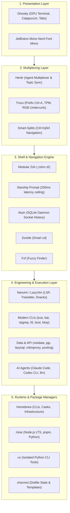

# 🚀 sam-setup

> **One line, walk away, come back to a Mac that works like mine** — an identical, zero-friction replica of an elite developer terminal environment: Ghostty, Neovim (LazyVim), Herdr agent multiplexer, Tmux, Starship, Atuin, modern CLI utilities, data wranglers, AI coding agents, and polyglot runtimes. Your identity stays yours; none of my secrets or private history come along.

<p align="center">
  <a href="https://github.com/sambatia/sam-setup/releases"></a>
  <a href="https://www.apple.com/macos/"></a>
  <a href="https://www.gnu.org/software/bash/"></a>
  <a href="https://github.com/sambatia/sam-setup/actions"></a>
  <a href="LICENSE"></a>
</p>

---

## 📋 Table of Contents

- [The Experience: What It Feels Like](#-the-experience-what-it-feels-like)
- [Architecture & Wiring](#-architecture--wiring)
- [Quick Install](#-quick-install)
  - [Installation Profiles](#installation-profiles)
  - [What Happens Under the Hood](#what-happens-under-the-hood)
- [The Superpower Toolset](#-the-superpower-toolset)
  - [1. Terminal Emulator & Typography](#1-terminal-emulator--typography)
  - [2. Multiplexing & Pane Navigation](#2-multiplexing--pane-navigation)
  - [3. Shell, Prompt, & History Engine](#3-shell-prompt--history-engine)
  - [4. Modern CLI Replacements](#4-modern-cli-replacements)
  - [5. AI Coding Agents & LLM Pipelines](#5-ai-coding-agents--llm-pipelines)
  - [6. Data Wrangling, Databases, & APIs](#6-data-wrangling-databases--apis)
  - [7. Editor Layer (LazyVim Stack)](#7-editor-layer-lazyvim-stack)
  - [8. Polyglot Runtimes & Package Managers](#8-polyglot-runtimes--package-managers)
- [Keyboard Shortcuts & Cheatsheet](#-keyboard-shortcuts--cheatsheet)
- [Maintenance & Diagnostic Suite](#-maintenance--diagnostic-suite)
- [Local Customization & Extension Points](#-local-customization--extension-points)
- [Security, Privacy, & Zero-Credential Policy](#-security-privacy--zero-credential-policy)
- [Rollback & Uninstallation](#-rollback--uninstallation)
- [License](#-license)

---

## 🌟 The Experience: What It Feels Like

Most terminal configurations are loose collections of shell aliases and dotfiles accumulated over years. `sam-setup` is an **engineered developer environment** built around ergonomic flow, microsecond responsiveness, and multi-agent AI pairing:

* **Instant Launch:** Opening your terminal boots Ghostty with GPU acceleration, 90% opacity blur, Catppuccin Mocha palette, and JetBrains Mono Nerd Font typography.
* **Fluid Pane Navigation:** Press `Ctrl + h/j/k/l` to move seamlessly between your Neovim buffer, an interactive terminal pane, and an AI agent session without your hands ever leaving the home row.
* **Intelligent Shell History:** Hit `Ctrl + r` or `Up Arrow` to invoke Atuin's fuzzy history engine with execution durations, exit codes, multi-line editing, and directory-scoped search.
* **Lightning Data Wrangling:** Open a 500 MB CSV with `vd data.csv` in under 200 ms, slice and dice columns with VisiData, or prototype complex JSON queries in real time with `jqp`.
* **Integrated AI Workflows:** Launch Claude Code or OpenAI Codex CLI with your terminal context intact, or pipe live system logs directly into language models via `cat error.log | llm "explain this failure"`.
* **Coordinated Single-Command Updates:** Run `update-all` (or `sam-setup-update`) to synchronize Homebrew, Mise runtimes, global Node CLIs, uv tools, LazyVim plugins, Tmux plugins, and dotfiles in a single safe pass.

---

## 🏗 Architecture & Wiring

The ecosystem is layered to guarantee high performance, clear package ownership, and zero PATH conflicts:



---

## ⚡ Quick Install

Paste this single command into macOS Terminal and press Enter:

```bash
/bin/bash -c "$(curl -fsSL https://raw.githubusercontent.com/sambatia/sam-setup/main/bootstrap.sh)"
```

### Installation Profiles

You can choose your footprint depending on your workflow needs:

```bash
# 1. Full Installation (Recommended - Complete AI engineering, Cloud/K8s, DB & Terminal stack)
/bin/bash -c "$(curl -fsSL https://raw.githubusercontent.com/sambatia/sam-setup/main/bootstrap.sh)"

# 2. Core Profile (Lightweight - Shell, Ghostty, LazyVim, Multiplexers, & Modern CLIs only)
/bin/bash -c "$(curl -fsSL https://raw.githubusercontent.com/sambatia/sam-setup/main/bootstrap.sh)" -- --core

# 3. Unattended / Automated (Skips the interactive confirmation prompt)
SAM_SETUP_YES=1 /bin/bash -c "$(curl -fsSL https://raw.githubusercontent.com/sambatia/sam-setup/main/bootstrap.sh)"
```

### What Happens Under the Hood

The `bootstrap.sh` pipeline executes a 10-phase automated setup:

```
[01/10] Pre-flight Guards   ── Verifies macOS 13+, arm64/Intel, >=10 GB disk space, & battery level.
[02/10] Sudo Keep-Alive     ── Caches admin credentials in background so GUI cask downloads never stall.
[03/10] Core Prerequisites  ── Installs Xcode Command Line Tools, Rosetta 2 (if Apple Silicon), & Homebrew.
[04/10] Identity Isolation  ── Prompts for your Name and Git Email to generate your private .gitconfig.
[05/10] Safety Backup       ── Copies existing ~/.zshrc, ~/.tmux.conf, ~/.config/nvim to *.bak-<timestamp>.
[06/10] Toolchain Bundle    ── Installs 55+ curated CLIs, Ghostty, Nerd Fonts, and casks via Brewfile.
[07/10] Polyglot Runtimes   ── Installs Node.js LTS, pnpm, and developer runtimes via mise and uv.
[08/10] Editor Sync         ── Headlessly initializes LazyVim plugins and clones tmux TPM plugins.
[09/10] SSH Keygen          ── Generates an ed25519 SSH key ONLY if no private key currently exists.
[10/10] Health Check        ── Executes sam-setup-check (44 assertions) and offers to launch Ghostty.
```

> [!TIP]
> **Safety Guarantee:** Your pre-existing configuration files are never destroyed. They are backed up to timestamped archives and can be restored at any time with a single command: `sam-setup-restore`.

---

## 🧰 The Superpower Toolset

Every tool in `sam-setup` was chosen according to the **"one winner per niche"** principle — zero duplicate tools fighting over PATH or system sockets.

### 1. Terminal Emulator & Typography
* **[Ghostty](https://ghostty.org/) (v1.3+):** Next-generation, GPU-accelerated terminal emulator written in Zig. Configured with native macOS tabs (`Cmd+t`), split panes (`Cmd+d`), Catppuccin Mocha colors, and 90% opacity with window blur.
* **[JetBrains Mono Nerd Font Mono](https://www.jetbrains.com/lp/mono/):** High-legibility developer font with programming ligatures, crisp rendering, and full Powerline/Nerd Font glyph coverage.

### 2. Multiplexing & Pane Navigation
* **[Tmux](https://github.com/tmux/tmux) (v3.5+):** 
  - Ergonomic `Ctrl-A` prefix (replaces awkward `Ctrl-b`).
  - True-color 24-bit RGB pass-through and undercurl styling for Neovim diagnostics.
  - Intuitive window splits: `prefix + |` (vertical) and `prefix + -` (horizontal).
  - Mouse mode toggle with `prefix + m`.
  - Managed plugins via TPM: `tmux-sensible`, `tmux-resurrect`, `tmux-continuum`, `tmux-yank`, `tmux-fzf`, and `tmux-ukiyo`.
* **[Herdr](https://github.com/danbuhler/herdr):** Agentic terminal multiplexer designed specifically for AI workflows, featuring pane topic synchronization and status bar integration.
* **Smart-Splits (`vim-tmux-navigator`):** Unified navigation binding `Ctrl-h`, `Ctrl-j`, `Ctrl-k`, `Ctrl-l` that traverses seamlessly across Neovim splits, Herdr panes, and Tmux windows.
* **[Workmux](https://github.com/raine/workmux):** Automated Git worktree isolation for spawning parallel coding agent tasks in independent tmux windows.

### 3. Shell, Prompt, & History Engine
* **Modular Zsh Architecture:** Structured startup sequence:
  `~/.zshenv` $\rightarrow$ `~/.zprofile` $\rightarrow$ `~/.zshrc` $\rightarrow$ `~/.zshrc.d/*.zsh` $\rightarrow$ `~/.zshrc.local` (your personal overrides).
* **[Starship](https://starship.rs/):** Ultra-fast, two-line prompt displaying Git branch and dirty state, language runtime versions (Node, Python, Rust, Go), command execution duration, and exit status, with a strict 250ms latency ceiling.
* **[Atuin](https://atuin.sh/):** SQLite daemon-backed history search accessible via `Ctrl-r` or `Up Arrow`. Provides instant fuzzy filtering, execution time, exit codes, and multi-line script navigation. Configured in local-only mode for absolute privacy.
* **[Zoxide](https://github.com/ajeetdsouza/zoxide):** Smarter `cd` command that learns your habits. Type `z project` to jump directly into deeply nested directories.
* **[Fzf](https://github.com/junegunn/fzf):** Fuzzy finder integrated into shell shortcuts (`Ctrl-t` to search files, `Alt-c` to navigate directories) and Git commands via `fzf-git`.

### 4. Modern CLI Replacements
Replace antiquated Unix utilities with fast, syntax-highlighted, Rust-powered alternatives:

| Legacy Tool | Modern Winner | Command | Superpower |
| :--- | :--- | :--- | :--- |
| `ls` | **[eza](https://github.com/eza-community/eza)** | `l`, `ll`, `lt` | Colorized metadata, git status per file, tree views, icon support. |
| `cat` | **[bat](https://github.com/sharkdp/bat)** | `bat <file>` | Syntax highlighting for 200+ languages, line numbers, git change indicators. |
| `grep` | **[ripgrep](https://github.com/BurntSushi/ripgrep)** | `rg "<pattern>"` | Recursive search respecting `.gitignore`, 10x faster than GNU grep. |
| `find` | **[fd](https://github.com/sharkdp/fd)** | `fd <name>` | Intuitive syntax, colorized output, regex support, ignores hidden files by default. |
| `du` | **[dust](https://github.com/bootandy/dust)** | `dust` | Graphical tree view showing exactly what is consuming your disk space. |
| `top` | **[btop](https://github.com/aristocratos/btop)** | `btop` | Gorgeous TUI system monitor showing CPU, memory, disks, network, and processes. |
| `ps` | **[procs](https://github.com/dalance/procs)** | `procs <name>` | Colorized process viewer with tree views, port usage, and memory consumption. |
| `curl` | **[xh](https://github.com/ducaale/xh)** | `xh <url>` | Friendly HTTP client with automatic JSON formatting and syntax highlighting. |
| `ping` | **[gping](https://github.com/orf/gping)** | `gping <host>` | Visual, real-time graph of ping latency over time. |
| `sed` | **[sd](https://github.com/chmln/sd)** | `sd "before" "after"` | Modern find-and-replace using regex with intuitive syntax. |
| `cut` | **[choose](https://github.com/theryangeary/choose)** | `choose 1 3` | Human-friendly field selector using Python-style slice indexing. |

### 5. AI Coding Agents & LLM Pipelines
* **[Claude Code](https://claude.ai/code):** Anthropic's official agentic coding assistant installed via the native Homebrew cask (`claude-code@latest`). Fully wired into local Git and MCP tools.
* **Codex CLI:** OpenAI's terminal coding assistant managed through Mise.
* **[llm](https://llm.datasette.io/) (v0.36):** Simon Willison's CLI utility for accessing local and cloud LLMs via standard Unix pipes.
  - Pre-configured with **`llm-ollama`** plugin to connect directly to local Ollama models (`http://localhost:11434`) without requiring cloud API keys.
  - Example: `cat error.log | llm "explain why this failed and propose a fix"`

### 6. Data Wrangling, Databases, & APIs
* **[VisiData](https://www.visidata.org/) (`vd`):** Interactive terminal multitool for opening, exploring, filtering, and summarizing large tabular datasets (CSV, TSV, JSON, SQLite, Parquet).
* **[jqp](https://github.com/noahgorstein/jqp):** Interactive TUI playground to prototype, test, and view `jq` queries against live JSON streams in real time.
* **[LazySQL](https://github.com/jorgerojas26/lazysql):** Keyboard-driven database management TUI supporting PostgreSQL, SQLite, and MySQL. Adheres to strict read-only safety by default.
* **[Posting](https://posting.sh):** Powerful terminal REST client with autocompletion, response formatting, and environment variables.
* **[mitmproxy](https://mitmproxy.org/):** Interactive TLS/HTTP interception proxy, headless dumper (`mitmdump`), and web-based dashboard (`mitmweb`) for debugging APIs and webhooks.
* **[Kondo](https://github.com/tbillington/kondo):** Blazingly fast build artifact cleaner. Scans project trees to find and delete bloated `node_modules`, `target`, `venv`, and `.cache` directories (`kondo -n` for dry run).
* **[Trippy](https://github.com/fujiapple852/trippy) (`trip`):** Interactive network diagnostic combining traceroute and ping into a responsive terminal UI.

### 7. Editor Layer (LazyVim Stack)
A complete, turnkey **[LazyVim](https://www.lazyvim.org)** configuration lives in `~/.config/nvim`:
* **Plugin Architecture:** Powered by `lazy.nvim` with reproducible lockfile pins.
* **Language Support:** Pre-configured LSP servers and linters installed via Mason (TypeScript, Python, Rust, Go, Markdown, Bash).
* **Syntax Trees:** High-performance syntax highlighting and text objects via `nvim-treesitter`.
* **Fast Navigation:** Telescope and Snacks.nvim pickers for instant file and code symbol search.
* **AI Assistance:** CodeCompanion plugin pre-wired for in-editor code completions and diff refactoring.

### 8. Polyglot Runtimes & Package Managers
* **[Homebrew](https://brew.sh/):** Manages CLI tools, fonts, and macOS applications.
* **[mise](https://mise.jdx.dev/):** Fast, polyglot version manager configured with Node.js LTS, pnpm, Codex CLI, and developer tools. Replaces slow shims like nvm, asdf, and pyenv.
* **[uv](https://docs.astral.sh/uv/):** Blazingly fast Python package and tool manager. Installs isolated CLI tools (`basedpyright`, `gita`, `mlx-lm`, `specify-cli`) in clean sandboxes.
* **[chezmoi](https://www.chezmoi.io/):** State engine that tracks your dotfiles in Git and renders templates dynamically.

---

## ⌨️ Keyboard Shortcuts & Cheatsheet

Type `sam-setup-help` in your terminal anytime to print this quick reference card:

### Tmux Multiplexer (Prefix: `Ctrl + a`)
| Key Combination | Action |
| :--- | :--- |
| **`Ctrl + a`** | **Tmux Prefix Key** (press this before any command below) |
| `prefix` then `\|` | Split pane vertically (side-by-side) |
| `prefix` then `-` | Split pane horizontally (stacked) |
| `prefix` then `c` | Create a new window |
| `prefix` then `n` / `p` | Next / previous window |
| `prefix` then `m` | Toggle mouse support (free scroll & copy) |
| `prefix` then `z` | Zoom/maximize current pane (toggle) |
| `prefix` then `Ctrl + s` | Save current tmux session layout to disk |
| `prefix` then `Ctrl + r` | Restore saved tmux session layout |
| `prefix` then `d` | Detach from session (leaves background tasks running) |

### Seamless Smart-Splits (Neovim + Tmux + Herdr)
| Key Combination | Action |
| :--- | :--- |
| **`Ctrl + h`** | Move focus to left pane / split |
| **`Ctrl + j`** | Move focus to lower pane / split |
| **`Ctrl + k`** | Move focus to upper pane / split |
| **`Ctrl + l`** | Move focus to right pane / split |

### Ghostty Terminal Shortcuts
| Key Combination | Action |
| :--- | :--- |
| **`Cmd + t`** | Open new native tab |
| **`Cmd + d`** | Split pane vertically right |
| **`Cmd + Shift + d`** | Split pane horizontally down |
| **`Cmd + w`** | Close current tab or split |
| **`Cmd + 1..9`** | Switch directly to tab 1 through 9 |
| **`Cmd + ,`** | Open Ghostty configuration file |

### Shell & Everyday Aliases
| Alias | Expanded Command | Purpose |
| :--- | :--- | :--- |
| **`l`** | `eza -la --icons` | Detailed directory listing with git status and icons |
| **`ll`** | `eza -l --icons` | Standard long listing |
| **`lt`** | `eza --tree --level=2 --icons` | Quick 2-level directory tree view |
| **`lg`** | `lazygit` | Interactive Git TUI (staging, commits, rebases, diffs) |
| **`ld`** | `lazydocker` | Interactive Docker container and image manager |
| **`spf`** | `superfile` | Graphical file manager with image previews |
| **`vd <file>`** | `visidata <file>` | Open CSV/TSV/JSON/Parquet in spreadsheet wrangler |
| **`z <dir>`** | `zoxide <dir>` | Jump to matching directory by frecency |
| **`Ctrl + r`** | `atuin search` | Search shell history with SQLite daemon engine |
| **`Ctrl + t`** | `fzf-file-widget` | Fuzzy file search and insert into command line |

---

## 🛠 Maintenance & Diagnostic Suite

Your environment comes with five purpose-built management utilities:

```
sam-setup-check   ── 44-point automated health verification suite
sam-setup-doctor  ── Self-healing doctor that automatically repairs shims, TPM, & hooks
sam-setup-help    ── Instant interactive cheatsheet of keybindings & commands
sam-setup-update  ── One-command updater for Homebrew, mise, uv, Neovim, & dotfiles
sam-setup-restore ── One-command rollback to pre-installation backup state
```

### 1. Health Verification (`sam-setup-check`)
Runs 44 non-destructive assertions validating system architecture, package managers, CLI utilities, runtime versions, fonts, and shell configuration syntax:
```bash
sam-setup-check
```

### 2. Self-Healing Doctor (`sam-setup-doctor`)
If a network timeout interrupted a plugin installation or mise shims drifted, run the doctor:
```bash
sam-setup-doctor
```
The doctor automatically clones missing TPM plugins, reshimms mise paths, re-registers agent hooks, and displays `✨ Applied X automatic fix(es)`.

### 3. One-Command Upgrades (`update-all` / `sam-setup-update`)
Synchronizes your entire workstation in one coordinated pass:
```bash
update-all    # or: sam-setup-update
```
* Runs `brew update && brew upgrade && brew cleanup`
* Upgrades Mise polyglot runtimes and global Node CLIs
* Upgrades standalone Python tools via `uv tool upgrade --all`
* Headlessly synchronizes Neovim Lazy plugins
* Updates Tmux TPM plugins
* Re-applies dotfiles cleanly via `chezmoi update`
* Validates Zsh syntax post-update to prevent terminal lockouts

---

## 🎨 Local Customization & Extension Points

`sam-setup` is built so you can layer your own personal preferences on top without creating merge conflicts with future upstream updates:

### Personal Shell Tweaks: `~/.zshrc.local`
Place private environment variables, custom PATH modifications, API keys, and aliases here:
```bash
# ~/.zshrc.local (created automatically if missing; never committed to git)
export GITHUB_TOKEN="ghp_your_personal_token"
export OPENAI_API_KEY="sk_your_api_key"
alias myproject="cd ~/Projects/my-project && tmux"
```
`~/.zshrc` automatically sources this file at the end of its initialization sequence.

### Personal Ghostty Tweaks: `~/.config/ghostty/config.local`
Override font sizes, window padding, background opacity, or custom keybindings here:
```ini
# ~/.config/ghostty/config.local
font-size = 14
background-opacity = 0.95
```
Ghostty automatically merges these overrides on top of the base Catppuccin theme.

### Pulling Future Improvements
When new tools or improvements are pushed to `sam-setup`, pull them down at any time:
```bash
chezmoi update
```
Your local overrides in `~/.zshrc.local` and `~/.config/ghostty/config.local` will remain completely untouched.

---

## 🔒 Security, Privacy, & Zero-Credential Policy

`sam-setup` is designed to be shared safely with colleagues without leaking private credentials:

* **Zero Shared Credentials:** None of Sam's SSH private keys, API keys, cloud tokens, Keychain items, or database passwords exist in this repository.
* **Independent Git Identity:** Chezmoi prompts for *your* name and email during bootstrap, configuring your own Git identity in `~/.gitconfig`.
* **Zero Telemetry:** No tracking scripts, analytics beacons, or phone-home telemetry.
* **Safe Database Posture:** All database clients (`lazysql`, `pgcli`) default to strict read-only posture.
* **Isolated History:** Shell history is stored in a local, unshared SQLite database managed by Atuin on your machine. Cloud history syncing is disabled by default.

---

## ⏪ Rollback & Uninstallation

If you ever wish to remove `sam-setup` and restore your original Mac configurations:

```bash
sam-setup-restore
```

The restore script finds your pre-installation `.bak-<timestamp>` archives and restores `~/.zshrc`, `~/.tmux.conf`, `~/.config/nvim`, and other dotfiles back to their exact original states.

---

## 📄 License

Distributed under the MIT License. See [LICENSE](LICENSE) for details.

Copyright (c) 2026 Sameh Abdalla.
